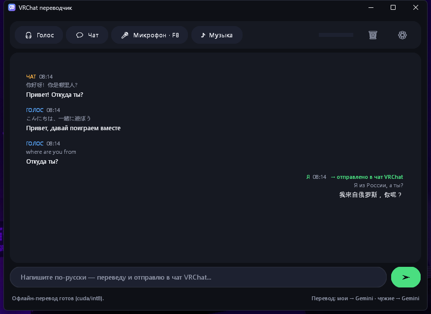
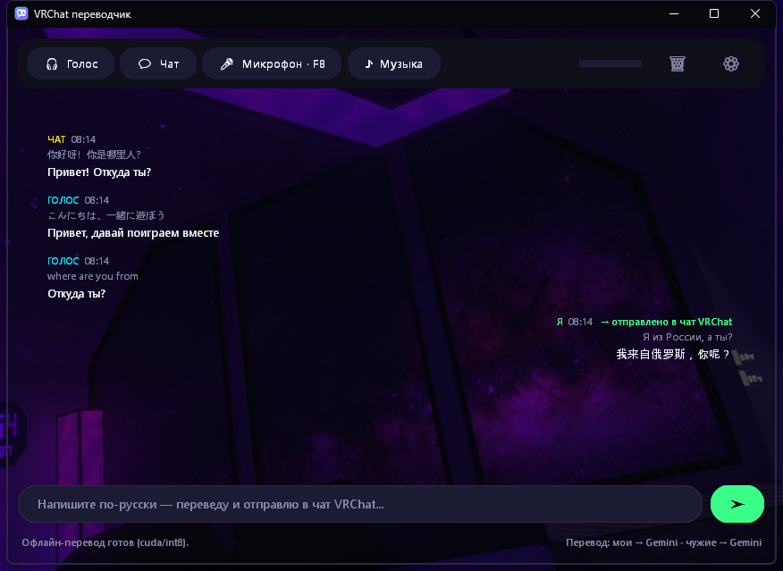
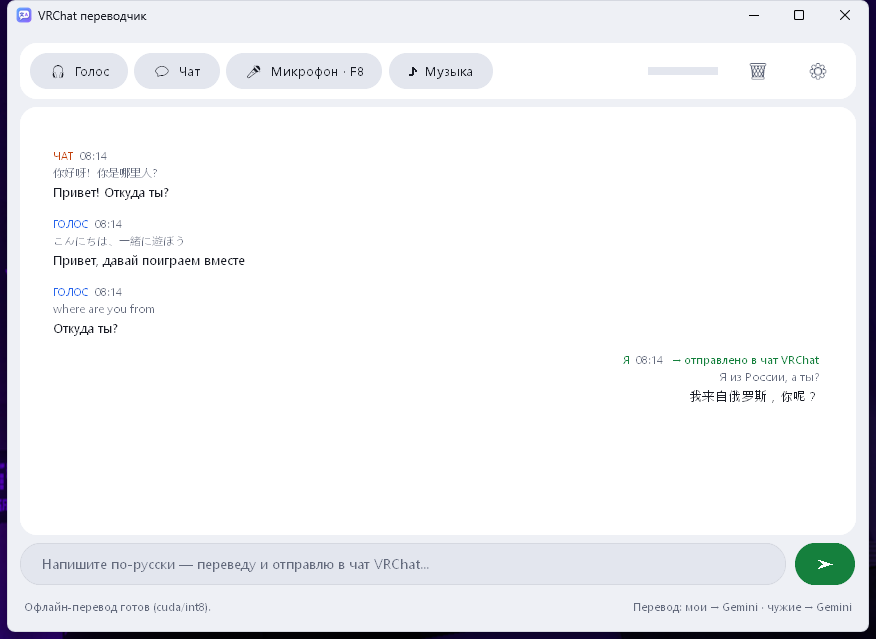
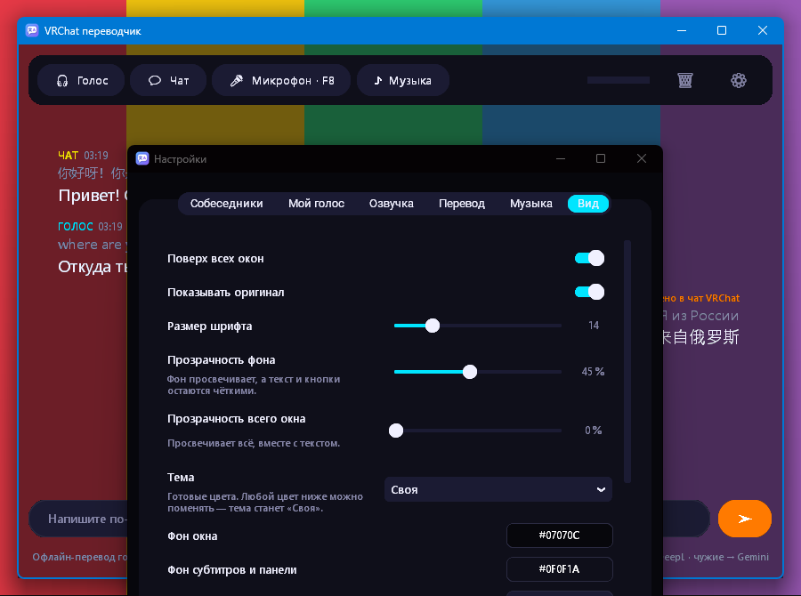
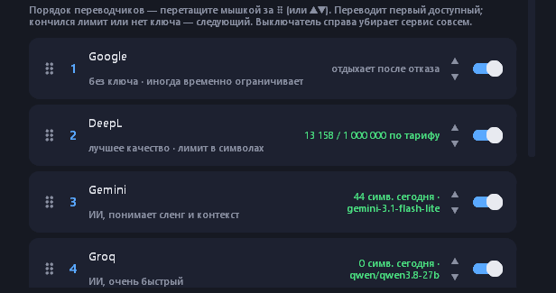
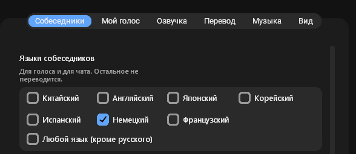
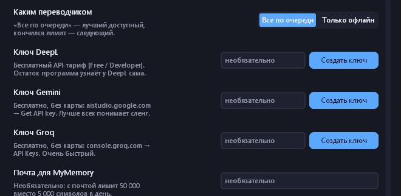
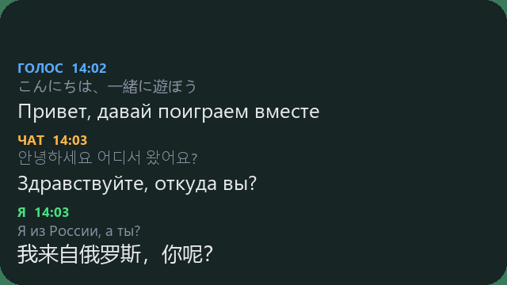
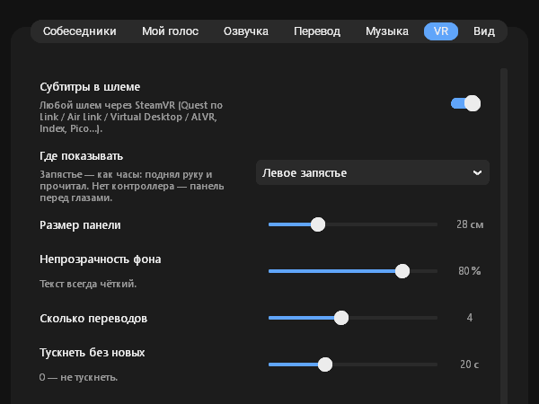
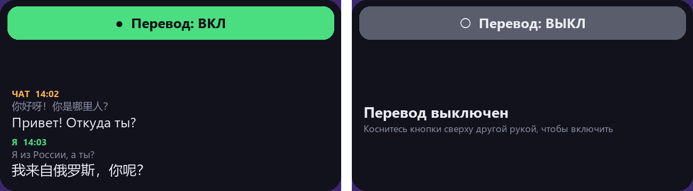

# VRChat Translator

[Русский](README.md) | **English**

### [⬇ Download VRChat-Translator-Lite-Setup.exe](https://github.com/LAZYGOFF/vrchat-translator/releases/latest/download/VRChat-Translator-Lite-Setup.exe)

Run the downloaded file and it does the rest. All versions: [Releases](https://github.com/LAZYGOFF/vrchat-translator/releases).

> **There is a full version with VR support**: subtitles on your wrist right inside the headset (any headset via SteamVR),
> a "Translation on/off" button you tap with your other hand, speech translation on a controller button. It gets updates first.
>
> How to get it: donate at least **200 RUB** on **[DonationAlerts](https://www.donationalerts.com/r/lazygo)** and **put your
> Telegram username in the donation message**, and I will message you and send the full version with a personal key.
>
> 200 RUB in other currencies (approximately, Bank of Russia rate on 2026-10-17):
> **$2.40** · **€2.15** · **¥16** · **1 080 ₸** · **108 ₴** · **7.20 BYN**

> **Note:** the program's interface is in Russian for now, and subtitles are in Russian by default.
> To get subtitles in another language, set `"target_lang"` in `config.json` (for example `"en"`).

**Other players → you.** A window on your PC with subtitles:
- **Voice**: everything you hear in your headphones (other players' voices) is recognized locally on your GPU (Whisper) and translated. Languages: Chinese, English, Japanese, Korean, Spanish, German, French, in any combination (checkboxes in the "Собеседники" / Other players tab) or "any language".
- **Chat**: every 2.5 s the program reads the VRChat window, finds chatboxes in the selected languages and translates new messages.

**You → other players.** Your voice or text is translated into the chosen language and appears in your VRChat chatbox:
- **Microphone [F8]**: press, say a phrase, press again. F8 also works while the game window is active. A short high beep means recording started, a low beep means it stopped.
- **Text box at the bottom of the window**: type and press Enter.

Speech and text recognition run offline. Translation uses "all services in turn" (see below), with an unlimited offline fallback.

## Screenshots

<table>
<tr>
<td width="50%"> Transparent background: the game shows through, text stays sharp (Neon theme)</td>
<td width="50%"> Light theme</td>
</tr>
<tr>
<td> ⚙ → Look: themes, transparency, custom colors</td>
<td> ⚙ → Translation: your own order of translators and usage of each</td>
</tr>
<tr>
<td> Other players' languages, any combination</td>
<td> Keys are optional; "Create key" opens the right page</td>
</tr>
</table>

**Full version only (VR):**

<table>
<tr>
<td width="50%"> Subtitle panel on your wrist in the headset</td>
<td width="50%"> ⚙ → VR: placement, size, opacity</td>
</tr>
<tr>
<td colspan="2"> "Translation: ON / OFF": tap it with a finger of your other hand</td>
</tr>
</table>

## Window

- Four buttons at the top: **🎧 Voice**, **💬 Chat**, **🎤 Microphone · F8**, **♪ Music**. An active button is highlighted in its color. On the right: game volume meter, **🗑** (clear) and **⚙** (settings).
- Other players' messages are on the left (voice in blue, chat in yellow), yours on the right (green): the original in grey on top, the translation below in large text.
- At the bottom: the text box with the **➤** button. Under it: status, the current track and which translator is working right now.
- **All settings are in the ⚙ window**, with tabs: Other players, My voice, Text-to-speech, Translation, Music, Look. Changes apply immediately.

## Translation: free services only, in turn

The program uses the best available translator. If it runs out of quota or fails, the program switches to the next one automatically:

**DeepL → Gemini → Groq → Google → MyMemory → offline**

All services are free; none of them needs a bank card.

- **Without keys** it works right away: Google → MyMemory → offline.
- **Keys are optional**; paste them in ⚙ → Translation (how to get them is explained below). Next to each empty key field there is a **"Create key"** button that opens the right page.
  - **DeepL**: best quality for your own messages. Limited by characters (e.g. 1,000,000 per year), so by default it is used only for your messages.
  - **Gemini** (Google AI Studio): an AI model, best with slang, ~1 s per phrase. Limited by requests per day.
  - **Groq**: the Qwen AI model, very fast (~0.2 s), good with Chinese. Limited by requests per day.
  - An e-mail for MyMemory raises its limit from 5,000 to 50,000 characters per day.
- **Your own order of translators** (⚙ → Translation): drag a service by ⠿ (or use ▲▼). The first available one translates; on a limit or error the next one is used. A switch next to a service removes it completely (offline cannot be turned off, it is the fallback).
- A failed service takes a break (overloaded: 1 minute, rate limited: 10 minutes, daily/monthly quota: until the next period). Usage is shown in ⚙ → Translation.
- **The program picks Gemini and Groq models itself** from those available to your key (fast lite models). When Google or Groq retire old models, the program notices and switches.
- **Offline** (the NLLB-200 model on your GPU): unlimited fallback, 0.1–0.2 s per phrase. Worse with slang. In ⚙ → Translation you can choose "Offline only", and then no internet is needed for translation at all.
- **Privacy:** on free tiers, Gemini and Groq may use texts to improve their models. Do not send anything personal through the translator.

## Installation and launch

- **Requirements:** Windows 10/11, an NVIDIA GPU is recommended (speech recognition is much slower without it), about 3 GB of free space.
- **Easiest:** download [VRChat-Translator-Lite-Setup.exe](https://github.com/LAZYGOFF/vrchat-translator/releases/latest/download/VRChat-Translator-Lite-Setup.exe) and run it. It unpacks itself to `%LOCALAPPDATA%\VRChat Translator` and installs Python and the components. If Windows shows SmartScreen, click "More info", then "Run anyway".
- **From source:** run `install.bat` once: if Python 3.10–3.14 is not found, it downloads the official Python 3.12 from python.org and installs it for the current user (no admin rights needed), then downloads the components (~3 GB, mostly CUDA libraries).
- **Launch:** `run.bat` (with a console), or build the launcher `VRChat Translator.exe` with `tools\build_exe.bat` (no console window).
- The first speech recognition downloads the model (small ≈ 500 MB, large-v3-turbo ≈ 1.6 GB).
- If something does not start, the program shows an error window. All messages are written to `app.log`.
- **One-file build for a friend:** `tools\build_share_exe.bat` → `VRChat Translator Setup.exe` (~250 KB) appears next to the folder. It contains only the program, without your keys and settings. On your friend's PC it unpacks itself to `%LOCALAPPDATA%\VRChat Translator`, installs Python if needed and downloads the components.
- **Archive for a friend:** `tools\make_share.bat` → `VRChat-Translator.zip`. Your keys (`config.json`), usage counters (`usage.json`), the log and `.venv` are not included. Do not zip the whole folder yourself, the keys would go with it.

## How to get a DeepL key (optional, ~5 minutes)

Translation works without a key too. A DeepL key gives better quality for your messages.

1. Open **deepl.com/pro-api#api-pricing** and switch the plans to **API** (the translator's own paid plans are shown by default, you don't need them). Choose a free API plan (**API Free** or **API Developer**) and sign up.
2. In your account, open the API keys and copy the key (a free key ends with `:fx`).
3. In the translator: **⚙ → Translation → DeepL key** → paste (Ctrl+V) → Enter. The key is saved immediately.

Free plans differ in volume: e.g. **API Developer** gives 1,000,000 characters per year. Every 10 minutes the program asks DeepL how much is used and shows it in ⚙ → Translation. When the quota runs out, it simply switches to the next service. No money is charged on the free plan.

DeepL may not accept your card or country. Then skip the key. Gemini and Groq translate just as well.

## How to get Gemini and Groq keys (free, no card, ~2 minutes)

- **Gemini:** **aistudio.google.com/apikey** → sign in with your Google account → accept the terms on the first visit → **Create API key** → **Copy key** → in the translator ⚙ → Translation → "Gemini key" → Ctrl+V → Enter.
- **Groq:** **console.groq.com/keys** → sign up (Google sign-in works) → **Create API Key** → any name → **Submit** → **Copy** (the key is shown only once!) → in the translator ⚙ → Translation → "Groq key" → Ctrl+V → Enter.

Gemini and Groq are not available in every country. If a service does not work in yours, the program just skips it.

## Enable OSC in VRChat

Without it your translations will not reach the chatbox. In the game open **Action Menu → Options → OSC → Enabled**. You only need to do this once.

## My voice: automatic mode, review, text-to-speech (⚙)

- **"Translate my speech by itself (no button)"**: just talk, and every phrase is recognized, translated and sent automatically. Listening starts as soon as the program starts; F8 and the button pause it (green "● Listening" button). With **"Only when the VRChat mic is on"**, phrases are not translated while your microphone is muted in the game (VRChat reports this itself via OSC). "Uh", "hmm" and laughter are not sent. If it picks up quiet noises or does not hear you, change `mic_vad_threshold_db` in `config.json` (default −45; closer to zero means you need to speak louder).
- **"Review a phrase before sending"**: the recognized phrase goes into the text box first. Fix it if needed and press Enter.
- **"Speak my translation"**: the translation is also spoken by a voice into the selected device (by default Line 1 from Virtual Audio Cable). Offline **Piper** voices: English, Chinese, Japanese, Korean, Spanish, German, French. Each one is downloaded once (60–80 MB) into the program's cache; nothing is installed into Windows.
- **"My voice goes there too"** (on by default): the program passes your microphone into Line 1 together with the speech, with ~45 ms delay.
- **The only thing you need to do once:** VRChat → Settings → Audio → Microphone → **Line 1 (Virtual Audio Cable)**. Then the game hears both you and the spoken translation.
  - **Important:** your voice goes to Line 1 only while the translator is running. If you close it, VRChat does not hear you until you select your usual microphone again (or start the translator).
  - While the spoken translation is playing, the program does not listen to the game or your microphone, so it never translates its own speech in a loop.

## Music in the chatbox

The **"Music"** button shows what is playing on your PC above your head: "♪ Artist - Track [1:23/3:45]". It updates every 1.6 seconds without a notification sound. The track comes from Windows (Spotify, YouTube and music in the browser, players), the same source as the volume pop-up.

- When you send a message through the translator, the music **disappears for 20 seconds** so your message stays visible, then comes back.
- **If you type in VRChat's own chat with the keyboard**, the music waits too: press **H** (open chat) and the music pauses while you type; after **Enter** your message stays for 20 seconds; after **Esc** the music comes back immediately. The program only watches these three keys, only while VRChat is in the foreground, and never reads what you type.
  - If your chat opens with another key, put it in `config.json`, e.g. `"vrchat_chat_keys": ["Y"]`.
  - **In a VR headset** (chat via the menu, no keyboard) the program cannot tell you are typing. Turn "Music" off before writing, or write through the translator.
- The track updates every **1.6 s**. It cannot be more often: VRChat silently drops chatbox messages sent more often than ~1.5 s.

## Settings (⚙)

- **Other players**: languages (checkboxes, any combination, or "any language"; speech in other languages is skipped), game audio device, recognition model (`small`: ~1.2 s per phrase on a GTX 1660 Super; `large-v3-turbo`: more accurate, ~3.8 s), speech volume threshold, "chatboxes only".
- **My voice**: microphone, the language you speak, the language to translate into (English, Chinese, Japanese, Korean, Spanish, German, French), sending to the VRChat chat, automatic speech translation, "only when the VRChat mic is on", review before sending.
- **Text-to-speech**: speak the translation, output device, "my voice goes there too".
- **Translation**: mode, keys, your order of translators, state and usage of every service.
- **Music**: music in the chatbox, how long to hide it after your message.
- **Look**: always on top, show the original, font size, themes (Dark, Midnight, Graphite, Neon, Sakura, Light) and any custom color for each element. **Background transparency**: only the background is see-through, text and buttons stay sharp (handy over the game); **whole-window transparency**: everything is see-through, text included.

## Good to know

- A VRChat chatbox fits 144 characters; longer text is cut. Speak in short phrases.
- The program runs at a lower priority (CPU and GPU), so VRChat keeps its FPS.
- **The offline translation model** (NLLB-200 by Meta, ~620 MB, downloaded once) uses about 600 MB of video memory. It is loaded only when the online services fail or "Offline only" is selected, so normally it does not use your GPU at all. If VRChat starts to lag, set `"offline_device": "cpu"` in `config.json` (0.4–0.9 s per phrase on the CPU). The model's license is CC-BY-NC 4.0: non-commercial use only.
- The translator window is visible in screenshots and OBS. To hide it (e.g. on stream), set `"hide_from_capture": true` in `config.json`.
- **Where the chat image comes from.** The program captures the image directly from the VRChat window, so chatboxes are visible even if a browser, Discord or the translator window is on top of the game. If VRChat is **minimized**, the game draws nothing, and the program waits until it is restored.
- **How the program tells chat from other text.** Only light text on a dark greyish plate (like a VRChat chatbox) is translated. Not translated: name plates, "she/her" and "Instantiating" lines, world signs, UI icons, single characters. If real chatboxes are not picked up, set `"ocr_only_chatboxes": false` in `config.json`.
- **A chatbox is not translated?** Create a `chat_debug` folder in the program folder and turn "Chat" on: the program will save frames where text was visible but not translated, with a `.txt` explaining why. Only the last 40 frames are kept and they are never sent anywhere. Delete the folder to stop.
- **What is not translated.** Laughter and interjections ("haha", "lol", "xD", "哈哈哈", "hmm", "oh", "wow"), notes like "(laughs)" and "[Music]". A phrase with real words besides laughter is translated.
- **Copying.** Select text with the mouse and press Ctrl+C. Right-click opens a "Copy" menu.
- Voice translation arrives 1–3 s after the end of a phrase, chatboxes up to ~5 s.
- Reading chatboxes uses 2 CPU cores. Speech recognition uses the GPU.
- More options are in `config.json` (created when the program closes): hotkey `hotkey` (F1–F12, PAUSE, SCROLLLOCK, INSERT, HOME, END), OSC port `osc_port`, screen reading interval `ocr_interval`, device `device` (`auto`/`cuda`/`cpu`), subtitle language `target_lang`.

## Files

| File | What it does |
|---|---|
| `app.py` | ties all parts together (program logic) |
| `ui.py` | look: main window and settings window |
| `audio_capture.py` | system audio capture and microphone recording |
| `speech.py` | speech recognition (faster-whisper, CUDA) |
| `chat_ocr.py` | finding and reading chatboxes (RapidOCR) |
| `window_capture.py` | captures the VRChat window, even when covered |
| `translator.py` | translation through all services in turn, quotas and usage |
| `theme.py` | themes and colors |
| `backdrop.py` | semi-transparent background under the window, text stays sharp |
| `netcache.py` | remembers website addresses so slow DNS (up to ~10 s on some PCs) never delays translation |
| `osc.py` | sending text to the VRChat chatbox; reading the VRChat mic state |
| `hotkey.py` | global hotkey |
| `media.py` | what is playing in Windows (for music in the chatbox) |
| `keywatch.py` | notices that you are typing in VRChat's chat (H / Enter / Esc) |
| `tts.py` | text-to-speech (offline Piper, Windows voices as a fallback) |
| `mixer.py` | your microphone + speech → Line 1 (VRChat uses it as a microphone) |
| `audio_thread.py` | one thread for all audio devices (otherwise they break each other) |
| `offline.py` | offline translation (NLLB-200) |
| `textfilter.py` | what not to translate: laughter, interjections, Russian written in Latin letters |
| `config.py` | default settings |
| `tools\launcher.cs` | source of the `VRChat Translator.exe` launcher |
| `icon.ico` | icon (drawn by `tools\make_icon.py`) |

## License

The code of this program is licensed under the **GNU GPL v3** (the `LICENSE` file): you may freely use, modify and share it, but any program based on this code must also be distributed under GPL v3 with open source code.

Third-party parts are not included in the repository. They are downloaded during installation, and each has its own license:
- Python libraries from `requirements.txt`: under their authors' licenses;
- the offline translation model **NLLB-200** (Meta): **CC-BY-NC 4.0**, non-commercial use only;
- Piper voices and Whisper recognition models: under the licenses stated on their pages;
- online translators (DeepL, Gemini, Groq, Google, MyMemory): under the terms of those services; every user has their own keys.
