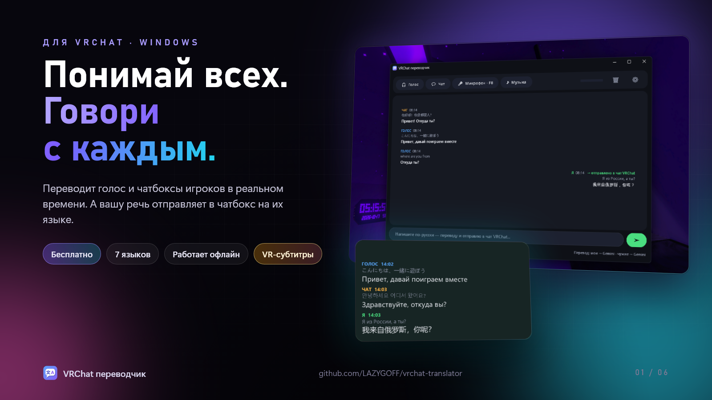
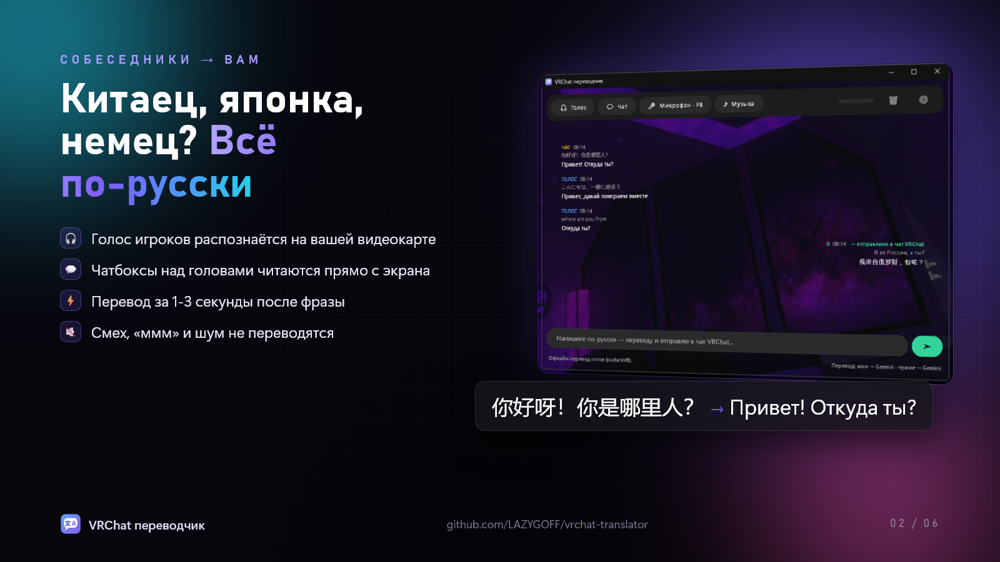
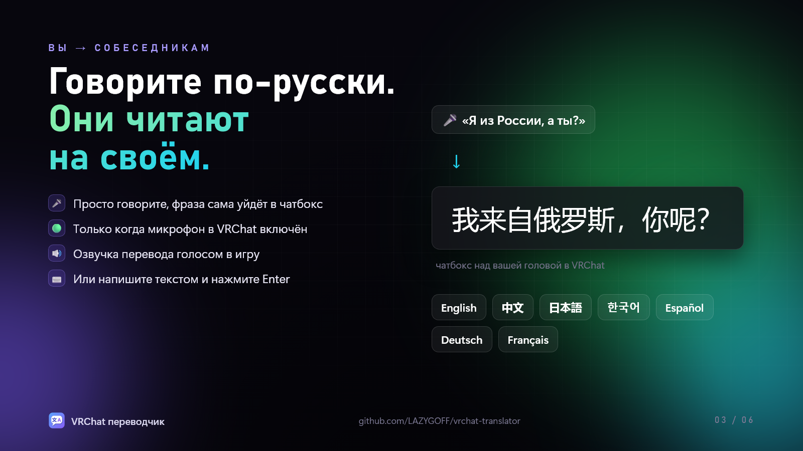
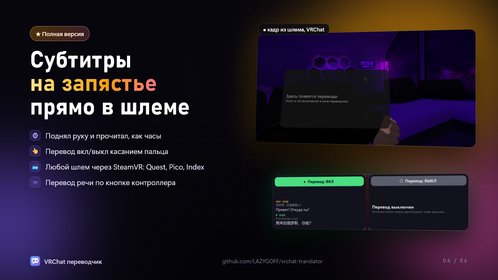
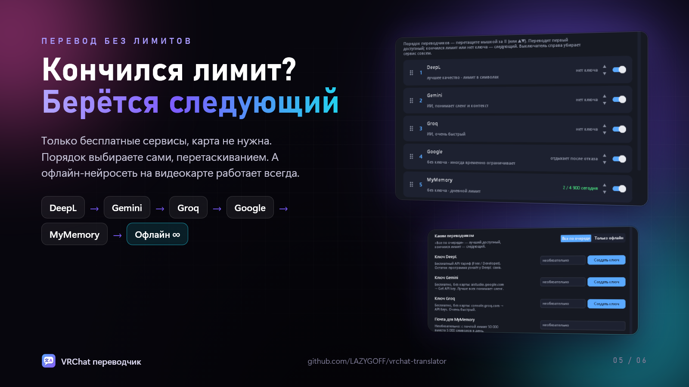
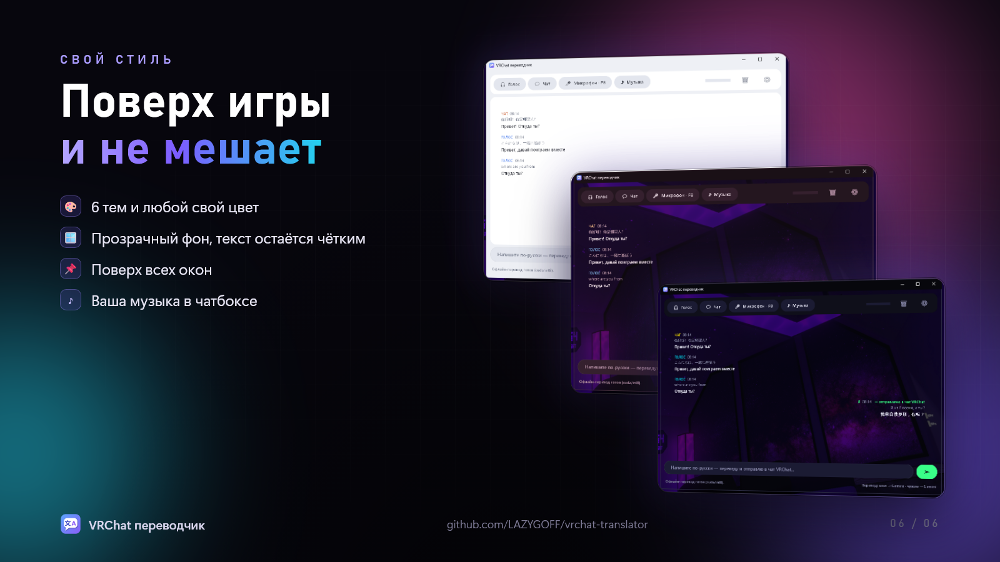

# VRChat переводчик

**Русский** | [English](README.en.md)

### [⬇ Скачать VRChat-Translator-Lite-Setup.exe](https://github.com/LAZYGOFF/vrchat-translator/releases/latest/download/VRChat-Translator-Lite-Setup.exe)

Запустите скачанный файл, остальное он сделает сам. Все версии: [Releases](https://github.com/LAZYGOFF/vrchat-translator/releases).

> **Есть полная версия с поддержкой VR**: субтитры на запястье прямо в шлеме (любой шлем через SteamVR),
> кнопка «Перевод вкл/выкл» касанием другой руки, перевод речи по кнопке контроллера. Обновляется первой.
>
> Как получить: задонатьте на **[DonationAlerts](https://www.donationalerts.com/r/lazygo)** от **200 ₽** и **в сообщении
> к донату укажите свой Telegram**, я напишу вам и пришлю полную версию с личным ключом.
>
> 200 ₽ в других валютах (примерно, по курсу ЦБ РФ на 17.10.2026):
> **$2.40** · **€2.15** · **¥16** · **1 080 ₸** · **108 ₴** · **7.20 BYN**

**Собеседники → вам.** Окно на ПК с русскими субтитрами:
- **Голос**: всё, что звучит в наушниках (голоса игроков), распознаётся локально на видеокарте (Whisper) и переводится. Языки: китайский, английский, японский, корейский, испанский, немецкий, французский. Можно любые вместе (галочки в «Собеседниках») или «любой язык».
- **Чат**: программа раз в 2,5 с читает окно VRChat, находит чатбоксы на нужных языках и переводит новые сообщения.

**Вы → собеседникам.** Ваш голос или текст переводится на выбранный язык и появляется в вашем чатбоксе в VRChat:
- **Микрофон [F8]**: нажмите, скажите фразу, нажмите ещё раз. F8 работает и тогда, когда активно окно игры. Короткий высокий сигнал означает начало записи, низкий означает конец.
- **Строка внизу окна**: напишите текст и нажмите Enter.

Распознавание речи и текста работает офлайн. Перевод идёт «всеми по очереди» (см. ниже), всегда есть безлимитный офлайн-запас.

## Как выглядит

## Окно

- Сверху четыре кнопки: **🎧 Голос**, **💬 Чат**, **🎤 Микрофон · F8**, **♪ Музыка**. Включённая кнопка подсвечивается своим цветом. Справа индикатор громкости игры, **🗑** (очистить) и **⚙** (настройки).
- Сообщения собеседников показываются слева (голос синим, чат жёлтым), ваши справа (зелёным): сверху серым оригинал, ниже крупно перевод.
- Внизу строка ввода с кнопкой **➤**. Под ней статус, текущий трек и какой переводчик сейчас работает («мои → DeepL · чужие → Google»).
- **Все настройки в окне ⚙**, вкладки: Собеседники, Мой голос, Озвучка, Перевод, Музыка, Вид. Изменения применяются сразу.

## Перевод: только бесплатные сервисы, по очереди

Программа берёт лучший доступный переводчик. Если у него кончился лимит или он отказал, она сама переходит к следующему:

**DeepL → Gemini → Groq → Google → MyMemory → офлайн**

Все сервисы бесплатные, ни для одного не нужна карта.

- **Без ключей** работает сразу: Google → MyMemory → офлайн.
- **Ключи необязательны**, вставляются в ⚙ → Перевод (как получить, написано ниже):
  - **DeepL**: лучшее качество для ваших сообщений. Лимит в символах (например, 1 000 000 на год), поэтому по умолчанию тратится только на ваши сообщения.
  - **Gemini** (Google AI Studio): ИИ-модель, лучше всех понимает сленг («cringe» → «кринж»), ~1 с на фразу. Лимит на запросы в день.
  - **Groq**: ИИ-модель Qwen, очень быстрая (~0,2 с), хороша в китайском. Лимит на запросы в день.
  - Почта для MyMemory поднимает его лимит с 5 000 до 50 000 символов в день.
- **Кто что переводит** (настраивается в ⚙ → Перевод): ваши сообщения → DeepL, а когда он кончится, Gemini/Groq. Речь и чат собеседников → Gemini → Groq → Google → MyMemory → офлайн.
- Отказавший сервис отдыхает (перегружен: 1 минуту, лимит запросов: 10 минут, дневной/месячный лимит: до следующего периода). Расход виден в ⚙ → Перевод.
- **Модели Gemini и Groq программа выбирает сама** из доступных вашему ключу (быстрые lite-модели). Google и Groq время от времени убирают старые модели, программа это заметит и перейдёт на другую.
- **Офлайн** (модель NLLB-200 на вашей видеокарте): безлимитный запас, 0,1–0,2 с на фразу. Сленг переводит хуже. В ⚙ → Перевод можно выбрать «Только офлайн», тогда интернет для перевода не нужен вообще.
- **Конфиденциальность:** на бесплатных тарифах Gemini и Groq тексты могут использоваться для улучшения их моделей. Не пишите через переводчик ничего личного.

## Установка и запуск

- **Что нужно:** Windows 10/11, желательно видеокарта NVIDIA (без неё распознавание речи заметно медленнее), около 3 ГБ свободного места.
- **Проще всего:** скачайте [VRChat-Translator-Lite-Setup.exe](https://github.com/LAZYGOFF/vrchat-translator/releases/latest/download/VRChat-Translator-Lite-Setup.exe) и запустите. Он распакуется в `%LOCALAPPDATA%\VRChat Translator`, сам поставит Python и компоненты. Если Windows покажет SmartScreen, нажмите «Подробнее», затем «Выполнить в любом случае».
- **Из исходников:** один раз запустите `install.bat`: если Python 3.10–3.14 не найден, он сам скачает официальный Python 3.12 с python.org и поставит его для текущего пользователя (без прав администратора), затем докачает компоненты (около 3 ГБ, в основном CUDA-библиотеки для видеокарты).
- **Запуск:** `run.bat` (с консолью) или соберите `VRChat Translator.exe` через `tools\build_exe.bat`, тогда окно открывается без консоли. На exe можно сделать ярлык на рабочий стол; сам exe не переносите отдельно от папки: он запускает программу, лежащую рядом.
- Первое распознавание речи скачивает модель (small ≈ 500 МБ, large-v3-turbo ≈ 1,6 ГБ).
- Если что-то не запускается, программа покажет окно с ошибкой. Все сообщения программы пишутся в `app.log`.
- `run.bat` по-прежнему работает: запускает с консолью, удобно, если нужно видеть сообщения вживую.
- Пересобрать exe (например, после смены иконки): `tools\build_exe.bat`. Иконку рисует `tools\make_icon.py`.
- **Поделиться с другом одним файлом:** `tools\build_share_exe.bat` → рядом с папкой появится `VRChat Translator Setup.exe` (~250 КБ). Внутри только программа, без ваших ключей и настроек. У друга exe сам распакуется в `%LOCALAPPDATA%\VRChat Translator`, сам поставит Python 3.12 (если его нет, без прав администратора) и докачает компоненты (~3 ГБ).
- **Поделиться с другом архивом:** `tools\make_share.bat` → рядом с папкой появится `VRChat-Translator.zip` (~170 КБ). В него не попадают ваши ключи (`config.json`), счётчики (`usage.json`), лог и `.venv`. Не архивируйте папку целиком, ключи уйдут вместе с ней.

## Как получить ключ DeepL (необязательно, ~5 минут)

Без ключа перевод тоже работает. Ключ DeepL нужен для лучшего качества ваших сообщений.

1. Откройте **deepl.com/pro-api#api-pricing** и переключите тарифы на **API** (по умолчанию там показаны платные тарифы самого переводчика, они не нужны). Выберите бесплатный API-тариф (**API Free** или **API Developer**) и зарегистрируйтесь.
2. В аккаунте откройте ключи API и скопируйте ключ (у бесплатного он заканчивается на `:fx`).
3. В переводчике: **⚙ → Перевод → Ключ DeepL** → вставьте (Ctrl+V) → Enter. Ключ сразу сохраняется. Внизу окна появится «мои → DeepL».

Объём у бесплатных тарифов разный: например, у **API Developer** 1 000 000 символов на год. Программа сама раз в 10 минут спрашивает у DeepL, сколько потрачено, и показывает это в ⚙ → Перевод («1 234 / 1 000 000 по тарифу»). Когда остаток кончится, она просто перейдёт на Google → MyMemory → офлайн. Деньги на бесплатном тарифе не списываются.

DeepL может не принять карту или страну. Тогда пропустите ключ, Gemini и Groq переводят не хуже.

## Как получить ключи Gemini и Groq (бесплатно, без карты, ~2 минуты)

- **Gemini:** **aistudio.google.com/apikey** → войдите своим Google-аккаунтом → при первом входе примите условия (галочка «мне 18 лет…») → **Create API key** → **Copy key** → в переводчике ⚙ → Перевод → «Ключ Gemini» → Ctrl+V → Enter.
- **Groq:** **console.groq.com/keys** → зарегистрируйтесь (можно через Google) → **Create API Key** → имя любое → **Submit** → **Copy** (ключ показывается только один раз!) → в переводчике ⚙ → Перевод → «Ключ Groq» → Ctrl+V → Enter.

Gemini и Groq доступны не во всех странах. Если сервис не работает в вашей, программа просто пропустит его.

## Включите OSC в VRChat

Без этого ваши переводы не попадут в чатбокс. В игре откройте **Action Menu → Options → OSC → Enabled**. Это нужно сделать один раз.

## Мой голос: авто-режим, проверка, озвучка (⚙)

- **«Переводить речь сам (без кнопки)»**: вы просто говорите, и каждая фраза сама распознаётся, переводится и отправляется. Слушание включается сразу при запуске программы; F8 и кнопка ставят его на паузу (зелёная кнопка «● Слушаю»). С переключателем **«Только когда в VRChat включён микрофон»** фразы не переводятся, пока микрофон в игре выключен (VRChat сам сообщает это по OSC). «Ага», «ммм», «эээ» и смех не отправляются. Пока вы говорите, музыка в чатбоксе не обновляется. Если ловит слишком тихие звуки или, наоборот, не слышит вас, поменяйте `mic_vad_threshold_db` в `config.json` (по умолчанию −45; чем ближе к нулю, тем громче нужно говорить).
- **«Проверять фразу перед отправкой»**: распознанная фраза не уходит сразу, а появляется в строке ввода внизу. Исправьте её при необходимости и нажмите Enter. Работает и с F8, и с авто-режимом.
- **«Озвучивать мой перевод»**: перевод не только пишется в чат, но и произносится голосом в устройство из «Озвучка в» (по умолчанию Line 1 от Virtual Audio Cable). Голоса офлайн-нейросети **Piper**: английский, китайский, японский, корейский, испанский, немецкий, французский. Каждый скачивается один раз (60–80 МБ) в кэш программы, в Windows ничего не ставится.
- **«Мой голос тоже туда»** (включено по умолчанию): программа сама пропускает ваш микрофон в Line 1 вместе с озвучкой, задержка около 45 мс. Это заменяет настройку Windows «Прослушивать с данного устройства».
- **Единственное, что нужно сделать вам один раз:** VRChat → Settings → Audio → Microphone → **Line 1 (Virtual Audio Cable)**. После этого в игре слышно и вас, и озвучку.
  - **Важно:** ваш голос идёт в Line 1, только пока переводчик открыт. Закрыли программу, и VRChat вас не слышит, пока вы снова не выберете в нём свой обычный микрофон (или не запустите переводчик).
  - Пока звучит озвучка, программа не слушает ни игру, ни ваш микрофон, чтобы не перевести собственную озвучку по кругу.
  - Голос по умолчанию для английского женский (lessac). Мужской: `"tts_voices": {"en": "en/en_US/ryan/medium/en_US-ryan-medium"}` в `config.json`. Громкость вашего голоса в Line 1 задаёт `mic_gain` (1.0 = как есть).

## Музыка в чатбоксе

Кнопка **«Музыка»** показывает над головой то, что у вас сейчас играет: «♪ Исполнитель - Трек [1:23/3:45]». Обновление идёт раз в 1,6 секунды, без звука уведомления. Трек берётся из Windows (Spotify, Яндекс Музыка, YouTube и музыка в браузере, плееры), то есть оттуда же, что показывает всплывающее окно громкости.

- Когда вы отправляете сообщение через переводчик (голосом по F8 или текстом), музыка **пропадает на 20 секунд**, чтобы сообщение спокойно висело, а потом возвращается. Пока идёт запись с микрофона, музыка тоже не обновляется.
- Если музыка остановилась или вы выключили кнопку, трек убирается из чатбокса. Ваше сообщение при этом не стирается.
- Время [1:23/3:45] показывается, только если плеер его сообщает. Браузеры иногда не сообщают, тогда будет просто название.
- **Если пишете в чат самого VRChat с клавиатуры**, музыка тоже не мешает. Нажали **H** (открыть чат), и музыка замирает, пока вы печатаете. После **Enter** ваше сообщение висит 20 секунд. После **Esc** музыка возвращается сразу. Программа смотрит только на эти три клавиши и только когда VRChat на переднем плане. Что вы печатаете, она не читает.
  - Если чат у вас открывается другой клавишей, впишите её в `config.json`, например `"vrchat_chat_keys": ["Y"]` (можно несколько: `["H", "Y"]`).
  - **В VR-шлеме** (чат через меню, без клавиатуры) программа не узнает, что вы пишете. Там выключайте «Музыку» перед сообщением или пишите через переводчик.
- Трек обновляется раз в **1,6 секунды**. Чаще нельзя: VRChat молча выбрасывает сообщения в чатбокс, если слать их чаще ~1,5 с. Нагрузки на компьютер почти нет (один опрос ~0,5 мс процессора).
- В `config.json`: `music_interval`: как часто обновлять (с, не меньше 1.6), `music_pause_s`: на сколько прятать после вашего сообщения (с), `music_prefix`: значок перед треком.

## Настройки (⚙)

- **Собеседники**: языки собеседников галочками, любые вместе, или «любой язык» (речь на других языках пропускается), звук игры, модель распознавания (`small`: ~1,2 с на фразу на GTX 1660 Super; `large-v3-turbo`: точнее, ~3,8 с), порог громкости речи, «только чатбоксы».
- **Мой голос**: микрофон, на каком языке вы говорите, на какой переводить (английский, китайский, японский, корейский, испанский, немецкий, французский), отправка в чат VRChat, «переводить речь сам (без кнопки)», «только когда в VRChat включён микрофон», проверка перед отправкой.
- **Озвучка**: озвучивать перевод, куда озвучивать, «мой голос тоже туда».
- **Перевод**: режим, ключи и **свой порядок переводчиков**: перетащите сервис мышкой за ⠿ (или ▲▼). Переводит первый доступный, при лимите или ошибке берётся следующий. Выключатель у сервиса убирает его совсем (офлайн выключить нельзя, он запасной). Там же видно состояние и расход каждого сервиса.
- **Музыка**: музыка в чатбоксе, на сколько прятать после вашего сообщения.
- **Вид**: поверх всех окон, показывать оригинал, размер шрифта, темы (Тёмная, Полночь, Графит, Неон, Сакура, Светлая) и любой свой цвет для каждого элемента (клик по образцу цвета). **Прозрачность фона**: просвечивает только фон, текст и кнопки остаются чёткими (удобно поверх игры); **прозрачность всего окна**: просвечивает всё, вместе с текстом.

## Важно знать

- В чатбокс VRChat помещается 144 символа, длиннее обрезается. Говорите короткими фразами.
- Программа работает с пониженным приоритетом (процессор и видеокарта), чтобы VRChat не терял FPS.
- **Офлайн-модель перевода** (NLLB-200 от Meta, ~620 МБ, скачивается один раз) занимает около 600 МБ видеопамяти. Она загружается, только когда онлайн-сервисы не ответили или выбран «Только офлайн», так что при обычной работе видеокарту не занимает. Если VRChat начнёт тормозить, поставьте `"offline_device": "cpu"` в `config.json` (на процессоре 0,4–0,9 с на фразу). Лицензия модели CC-BY-NC 4.0: только некоммерческое использование, для личного перевода в игре подходит.
- В строке статуса после отправки видно, через что прошёл перевод («DeepL», «Google», «офлайн», «кэш») и сколько он занял.
- Окно переводчика видно на скриншотах и в OBS. Если хотите его спрятать (например, на стриме), поставьте `"hide_from_capture": true` в `config.json`. Ваши отправленные сообщения обратно не переводятся.
- **Откуда берётся картинка для чата.** Программа снимает изображение прямо из окна VRChat, поэтому чатбоксы видны, даже если поверх игры открыт браузер, Discord или окно переводчика. Если VRChat **свёрнут**, игра ничего не рисует, и программа ждёт, пока его развернут.
- **Переводчик запускается только один раз.** При повторном запуске появится сообщение, что он уже открыт.
- **Как программа отличает чат от остального текста.** Переводится только светлый текст на тёмной сероватой плашке, как у чатбокса VRChat. Не переводятся: таблички с никами (они цветные или светло-серые), строки «she/her» и «Instantiating», вывески мира, значки интерфейса и одиночные иероглифы. Если настоящие чатбоксы не ловятся, поставьте `"ocr_only_chatboxes": false` в `config.json`: тогда будет переводиться любой текст на нужном языке.
- **Чатбокс не переводится?** Создайте в папке программы папку `chat_debug` и включите «Чат»: программа будет сохранять туда кадры, где был виден текст, но перевода не было, а рядом `.txt` с причиной (например, «фон: яркость 150»). Хранятся последние 40 кадров, никуда не отправляются. Удалите папку, и запись выключится.
- **Что не переводится.** Смех и междометия («haha», «lol», «xD», «哈哈哈», «hmm», «oh», «wow»), пометки вроде «(laughs)» и «[Music]», русская речь, русский текст латиницей («privet kak dela»), а также всё, что Google вернул без перевода (ники, ссылки). Фраза, где кроме смеха есть слова («haha that's funny»), переводится.
- **Копирование.** Выделите текст мышью и нажмите Ctrl+C (работает и с русской раскладкой). Правая кнопка мыши открывает меню «Копировать / Копировать эту строку / Копировать всё». В строке ввода работают Ctrl+V и меню по правой кнопке.
- Перевод голоса приходит с задержкой 1–3 с после конца фразы, чатбоксы с задержкой до ~5 с.
- Чтение чатбоксов занимает 2 ядра процессора. Распознавание речи нагружает видеокарту.
- Дополнительные параметры лежат в `config.json` (создаётся при закрытии программы): горячая клавиша `hotkey` (F1–F12, PAUSE, SCROLLLOCK, INSERT, HOME, END), порт OSC `osc_port`, частота чтения экрана `ocr_interval`, устройство `device` (`auto`/`cuda`/`cpu`).

## Файлы

| Файл | Что делает |
|---|---|
| `app.py` | связка всех частей (логика программы) |
| `ui.py` | внешний вид: главное окно и окно настроек |
| `audio_capture.py` | захват звука системы и запись микрофона |
| `speech.py` | распознавание речи (faster-whisper, CUDA) |
| `chat_ocr.py` | поиск и распознавание чатбоксов (RapidOCR) |
| `window_capture.py` | снимок содержимого окна VRChat, даже перекрытого |
| `translator.py` | перевод всеми сервисами по очереди, лимиты и расход |
| `theme.py` | темы и цвета оформления |
| `backdrop.py` | полупрозрачный фон под окном: фон просвечивает, текст остаётся чётким |
| `netcache.py` | запоминает адреса сайтов: если DNS отвечает медленно (бывает до ~10 с), перевод его не ждёт |
| `osc.py` | отправка текста в чатбокс VRChat |
| `hotkey.py` | глобальная горячая клавиша |
| `media.py` | что сейчас играет в Windows (для музыки в чатбоксе) |
| `keywatch.py` | замечает, что вы пишете в чат VRChat (H / Enter / Esc) |
| `tts.py` | озвучка перевода (Piper офлайн, запасной вариант: голоса Windows) |
| `mixer.py` | ваш микрофон + озвучка → Line 1 (VRChat слушает его как микрофон) |
| `audio_thread.py` | один поток для всех звуковых устройств (иначе они ломают друг друга) |
| `offline.py` | офлайн-перевод (NLLB-200) |
| `textfilter.py` | что не переводить: смех, междометия, русский латиницей |
| `config.py` | настройки по умолчанию |
| `VRChat Translator.exe` | запуск программы без консоли (исходник: `tools\launcher.cs`) |
| `icon.ico` | иконка (рисует `tools\make_icon.py`) |

## Лицензия

Код этой программы открыт по лицензии **GNU GPL v3** (файл `LICENSE`): его можно свободно использовать, менять и распространять, но любая программа на основе этого кода тоже должна распространяться под GPL v3 с открытым исходным кодом.

Сторонние части в репозиторий не входят. Они скачиваются при установке, и у каждой своя лицензия:
- библиотеки Python из `requirements.txt`: по лицензиям своих авторов;
- офлайн-модель перевода **NLLB-200** (Meta): **CC-BY-NC 4.0**, только некоммерческое использование;
- голоса озвучки Piper и модели распознавания Whisper: по лицензиям, указанным на их страницах;
- онлайн-переводчики (DeepL, Gemini, Groq, Google, MyMemory): по условиям этих сервисов, ключи у каждого пользователя свои.